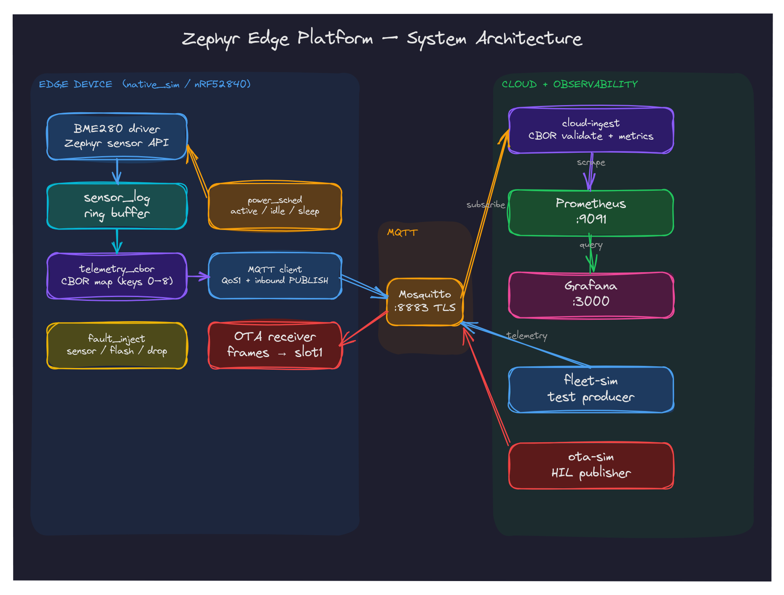

# zephyr-edge

Zephyr RTOS edge platform: BME280 sensor driver, MQTT/CBOR telemetry, MCUboot OTA, and Go cloud ingestion.



## Quick Start

```sh
devenv shell      # reproducible toolchain (Zephyr, west, cmake, ninja)
just build        # west build -b native_sim/native/64 firmware
just test         # run all ztest suites
just demo         # fleet simulator + cloud + Grafana pipeline
```

## Structure

`firmware/` Zephyr app + driver · `cloud/` Go ingestion · `infra/` observability · `tests/` fleet sim, e2e, HIL · `docs/` architecture, data model, OTA.

## Design Docs

[Architecture](docs/ARCHITECTURE.md) · [Data model](docs/DATA_MODEL.md) · [OTA](docs/OTA.md) · [Demo](docs/DEMO.md) · [Audit](docs/AUDIT.md) · [Roadmap](docs/ROADMAP.md) · [Procurement](docs/PROCUREMENT.md)

## References

- [Zephyr RTOS docs](https://docs.zephyrproject.org/latest/)
- [BME280 datasheet](https://www.bosch-sensortec.com/media/boschsensortec/downloads/datasheets/bst-bme280-ds002.pdf)
- [MCUboot docs](https://docs.mcuboot.com/)
- [paho.mqtt.golang](https://github.com/eclipse/paho.mqtt.golang)
- [fxamacker/cbor](https://github.com/fxamacker/cbor)

## License

MIT — see [LICENSE](LICENSE).
