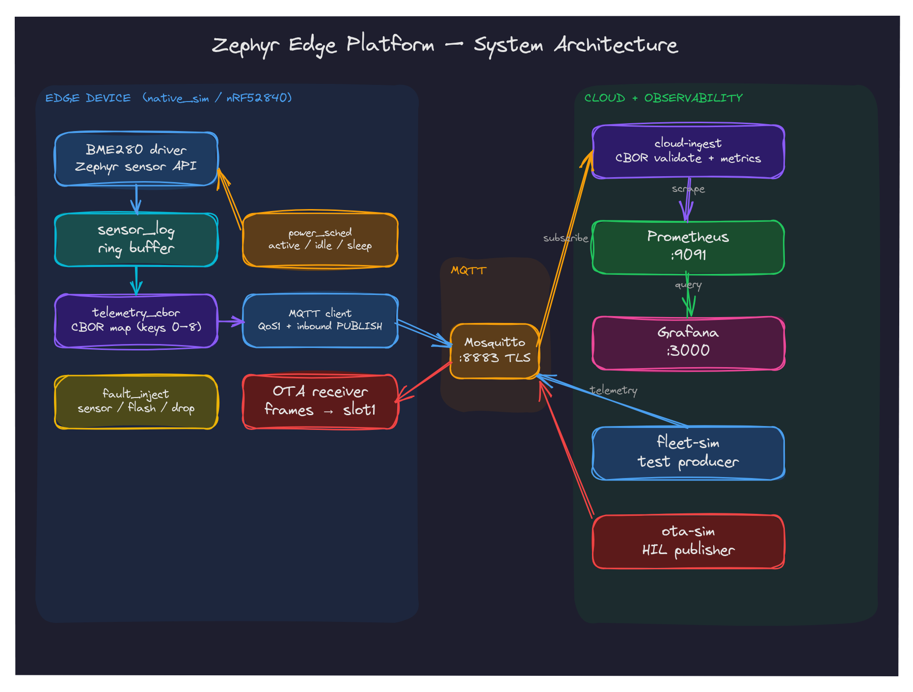

# cloud/ — Go telemetry ingestion service

MQTT subscriber that decodes CBOR telemetry payloads (per
[`../docs/DATA_MODEL.md`](../docs/DATA_MODEL.md) §1), validates the
topic/device identity, and exposes Prometheus metrics plus readiness.



## Configuration (environment variables)

| Variable | Default | Description |
|----------|---------|-------------|
| `MQTT_BROKER` | `tls://localhost:8883` | MQTT broker URL; use `tls://` in normal operation |
| `MQTT_TLS_CA` | `../infra/tls/ca.crt` | CA certificate for TLS (PEM) |
| `MQTT_TLS_SERVER_NAME` | broker hostname | Override certificate/SNI name |
| `MQTT_USERNAME` | `edge-ingest` | MQTT username (dev default) |
| `MQTT_PASSWORD` | `change-me` | MQTT password (dev default) |
| `MQTT_TOPIC` | `telemetry/+` | Subscription filter; must contain exactly one `+` level |
| `HTTP_ADDR` | `:9090` | HTTP listen address |
| `CLIENT_ID` | `cloud-ingest` | MQTT client identifier |

The filter's `+` level is the device ID and must equal payload key 1; mismatches
are dropped and counted in `telemetry_topic_mismatch_total`. Filters with `#` or
no `+` are rejected at startup.

TLS is verified against `MQTT_TLS_CA`; a missing CA or unreadable certificate
file is a fatal startup error. Plaintext `tcp://` is accepted only when
explicitly configured (for isolated tests). The committed CA/password are
local-development credentials (see [`../infra/tls/README.md`](../infra/tls/README.md)).

## Endpoints

- **`/metrics`** — Prometheus metrics (telemetry gauges, counters, validation stats)
- **`/health`** — JSON readiness: `200 {"status":"ok","mqtt_connected":true}` when
  connected, `503 {"status":"degraded","mqtt_connected":false}` otherwise
- **`/ready`** — alias of `/health`

## Prometheus Metrics

| Metric | Type | Labels | Description |
|--------|------|--------|-------------|
| `telemetry_messages_total` | counter | `device_id` | Total valid messages per device |
| `telemetry_decode_errors_total` | counter | — | CBOR decode failures |
| `telemetry_unknown_schema_total` | counter | — | Unsupported/missing schema_version |
| `telemetry_invalid_total` | counter | — | Missing required fields |
| `telemetry_out_of_range_total` | counter | `device_id`, `field` | Out-of-range values (still exported) |
| `telemetry_topic_mismatch_total` | counter | — | Topic device ID ≠ payload device ID |
| `telemetry_last_seen_timestamp_seconds` | gauge | `device_id` | Unix time of the last valid message |
| `telemetry_temperature_celsius` | gauge | `device_id` | Latest temperature (°C) |
| `telemetry_humidity_percent` | gauge | `device_id` | Latest humidity (%RH) |
| `telemetry_pressure_kpa` | gauge | `device_id` | Latest pressure (kPa) |
| `telemetry_seq` | gauge | `device_id` | Latest sequence number |

## Development

```bash
go test -race -count=1 ./...   # unit + main-package tests
go test ./telemetry -run Golden -v
go build .
go vet ./...
```

`telemetry/testdata/firmware-v1.cbor` is the byte-exact payload produced by the
firmware ztest; it locks the indefinite-length CBOR wire format.

## Docker

```bash
docker build -t cloud-ingest .
docker run --rm -p 9090:9090 \
  -v "$PWD/../infra/tls:/certs:ro" \
  -e MQTT_BROKER=tls://mosquitto:8883 \
  -e MQTT_TLS_CA=/certs/ca.crt \
  -e MQTT_USERNAME=edge-ingest -e MQTT_PASSWORD=change-me \
  cloud-ingest
```

The image runs as a non-root user (uid 10001).
