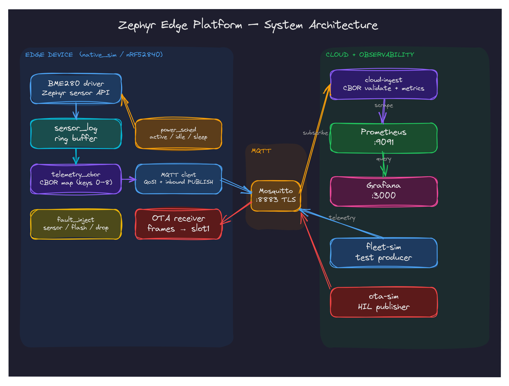
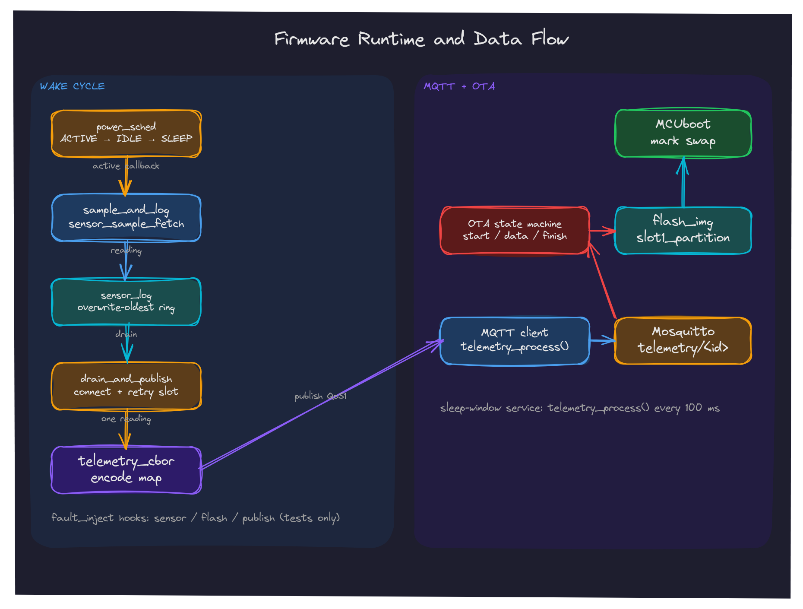
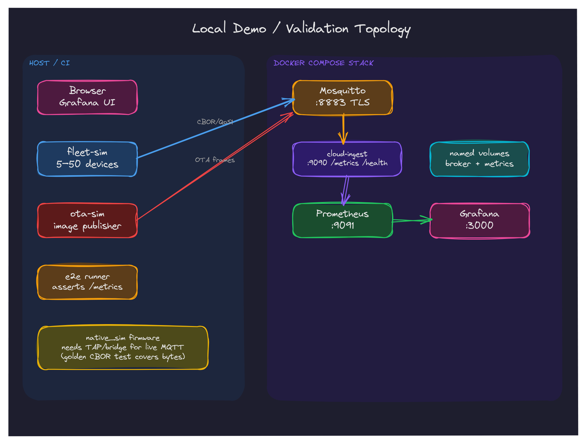

# Architecture

`zephyr-edge` is a reference edge-telemetry platform: a Zephyr device samples a
BME280, buffers readings, publishes CBOR telemetry over MQTT, accepts OTA
frames, and feeds a Go ingestion service whose metrics drive Prometheus and
Grafana.

## Components

| Component | Responsibility |
|-----------|----------------|
| `firmware/drivers/sensor/bme280_custom` | Zephyr sensor-subsystem driver over I2C; register-file emulator for `native_sim`. |
| `firmware/src/sensor_log.c` | Fixed-record ring buffer; overwrite-oldest; mutex-protected. |
| `firmware/src/power_sched.c` | ACTIVE → IDLE → SLEEP scheduler; PM policy locks; sleep-window service callback. |
| `firmware/src/telemetry` | CBOR encoder + MQTT client; reads/acks inbound PUBLISH, dispatches OTA frames. |
| `firmware/src/ota` | OTA state machine, flash staging, MCUboot mark; resubscribes on reconnect. |
| `firmware/src/fault_inject.c` | Kconfig-gated sensor/flash/packet fault hooks (tests only by default). |
| `cloud/` | MQTT → CBOR validation → Prometheus metrics; `/health` reflects broker readiness. |
| `infra/` | Mosquitto, cloud-ingest, Prometheus, Grafana compose stack. |
| `tests/fleet-sim` | Synthetic fleet producer; shares the cloud decoder contract tests. |
| `tests/ota-sim` | Host-side OTA frame publisher for HIL/bench use. |
| `tests/e2e` | Non-interactive pipeline test (Docker or local). |

## Firmware runtime flow

1. The power scheduler enters ACTIVE, holds the suspend lock, and calls
   `sample_and_log()`.
2. The BME280 is sampled through the Zephyr sensor API; the reading is pushed
   into the ring buffer (oldest overwritten when full).
3. After the cycle, the main loop connects if needed, drains the ring buffer,
   encodes each reading as CBOR, and publishes QoS1 to `telemetry/<device_id>`.
4. If the broker is unreachable, readings remain queued instead of being
   discarded; a failed publish is retained in a one-reading retry slot.
5. During SLEEP the scheduler releases the suspend lock and calls
   `telemetry_process()` every `CONFIG_POWER_SERVICE_INTERVAL_MS`, keeping
   keepalive/PUBACK/PUBLISH handling responsive (including OTA frames).
6. Inbound PUBLISH payloads are read from the socket, matched against
   `cmd/<device_id>/ota`, dispatched to the OTA state machine, and acknowledged.
7. The host `fleet-sim` path connects to Mosquitto over TLS 1.2+ with password
   authentication; the firmware build embeds the dev CA and uses the same
   transport.
8. OTA frames write to `slot1`; on finish the image is marked for MCUboot swap
   (or staged in the simulator).
9. The nRF52840 sysbuild adds MCUboot, which verifies the signed application
   before booting it; `native_sim` simulates the final swap.

## Wire contract

- Telemetry: `telemetry/<device_id>`, CBOR map with integer keys 0–8
  ([`DATA_MODEL.md`](DATA_MODEL.md)).
- OTA: `cmd/<device_id>/ota`, binary frames
  ([`OTA.md`](OTA.md)).
- The cloud requires the topic-derived device ID to equal key 1; mismatches are
  dropped and counted.
- A 75-byte firmware-produced CBOR payload is the shared golden fixture
  (`cloud/telemetry/testdata/firmware-v1.cbor` and the firmware ztest).

## Deployment / demo topology

- `just demo` starts the compose stack and the Go fleet simulator. This is the
  fully local, hardware-free path; it does not run the firmware binary because
  `native_sim` needs a host TAP/bridge for live MQTT.
- `E2E_MODE=local tests/e2e/run.sh` starts Mosquitto + cloud-ingest directly
  over TLS and publishes both fleet telemetry and the firmware golden payload.
- `just e2e` runs the Docker/Podman Compose variant (used by CI).
- `just firmware-tap` runs the actual `native_sim` firmware against a
  TLS+password Mosquitto over a rootless TAP, proving the embedded-CA handshake,
  authenticated CONNECT, and telemetry publish path.
- Real firmware telemetry requires either an nRF52840 (HIL roadmap) or the
  `native_sim` TAP setup documented by Zephyr; the wire bytes themselves are
  proven by the golden tests.

## Failure behavior

| Situation | Behavior |
|-----------|----------|
| Broker down at boot/after disconnect | Non-fatal; readings stay queued; connect retried each cycle. |
| Ring buffer full | Oldest record overwritten; `ring_dropped` logged. |
| Publish fails | One reading retained and retried; later readings stay queued. |
| OTA malformed/oversized | Session `ERROR`; no flash write; QoS1 ack still sent. |
| OTA overflow/mismatch | Session `ERROR`; log includes sizes. |
| Reconnect during OTA | Partial image abandoned; subscription re-established on CONNACK. |
| Cloud decode/schema/required-key error | Dropped + corresponding counter. |
| Cloud topic/device mismatch | Dropped + `telemetry_topic_mismatch_total`. |
| Cloud broker down | `/health` returns 503 until reconnected. |

## Design invariants

1. The firmware's CBOR bytes are locked by a golden test shared with the cloud.
2. The telemetry topic is consistent across firmware, cloud, compose, fleet-sim,
   and docs; `tests/scripts/check-contract.sh` fails otherwise.
3. OTA frames are bounded and parsed without `memmem`/unbounded `strtoul`.
4. The MQTT payload is read and acknowledged; inbound PUBLISH is not ignored.
5. Fault injection hooks are wired into the real sensor/flash/publish paths.
6. README stays terse; detailed architecture, data model, OTA, and roadmap live
   under `docs/`.
