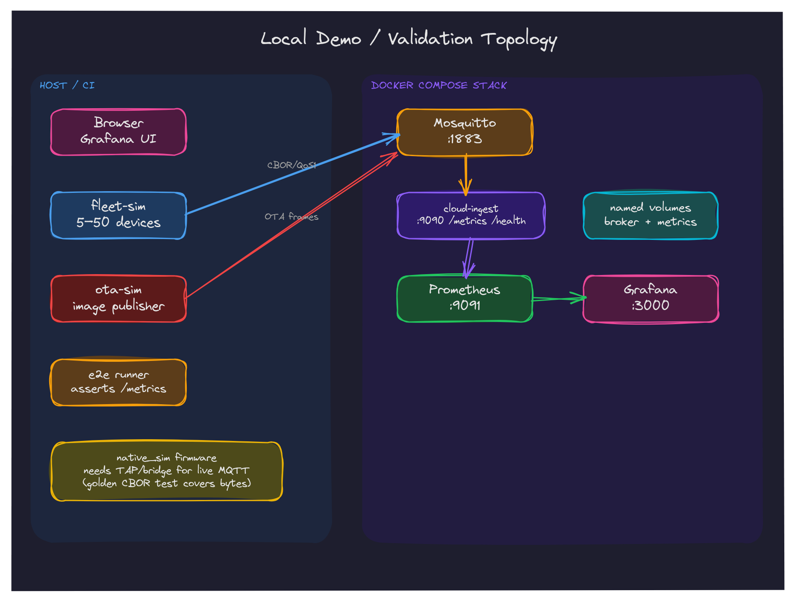

# End-to-End Demo

This guide walks through the local pipeline: a fleet of simulated edge devices
publishing CBOR telemetry over MQTT to the cloud ingestion service, with live
metrics in Prometheus and Grafana.

> The fleet simulator is used because the `native_sim` firmware needs a host
> TAP/bridge for live MQTT. The firmware's actual wire bytes are locked by the
> golden CBOR test (`cloud/telemetry/testdata/firmware-v1.cbor`) and exercised
> end-to-end by `tests/e2e/run.sh` in local mode.



## Prerequisites

| Tool | Purpose |
|------|---------|
| Docker or Podman with Compose | Runs Mosquitto, cloud-ingest, Prometheus, Grafana |
| Go ≥ 1.24 | Builds/runs the fleet simulator and cloud service |
| just | Task runner |
| curl, jq | Health checks and metric assertions |

All host tools are available inside `devenv shell` except the container runtime.

## Quick start

```bash
# From the repository root:
just demo                 # 10 simulated devices (default)
just demo devices=50      # 50 simulated devices
COMPOSE="podman compose" just demo   # Podman users
```

The command:

1. Starts the compose stack (Mosquitto → cloud-ingest → Prometheus → Grafana).
2. Waits for cloud-ingest `/health` (which now requires MQTT readiness).
3. Launches the fleet simulator, publishing CBOR on `telemetry/fleet-sim-<N>`.
4. Polls Prometheus until `telemetry_messages_total` shows devices.
5. Prints dashboard URLs; Ctrl-C stops the simulator and tears down the stack.

`just demo` exits non-zero if the pipeline never becomes healthy or no
telemetry is observed within 60s.

## Automated pipeline test

```bash
just e2e                  # Docker mode
E2E_MODE=local just e2e   # Mosquitto + cloud binary, no Docker (sandbox/VM)
```

The test publishes fleet telemetry, asserts cloud metrics, and (in local mode)
publishes the firmware's golden CBOR payload to prove the actual wire bytes are
accepted by the real cloud decoder.

## Dashboard URLs

| Service | URL | Credentials |
|---------|-----|-------------|
| Grafana | http://localhost:3000 | admin / admin |
| Prometheus | http://localhost:9091 | — |
| Cloud ingest | http://localhost:9090/metrics | — |
| MQTT broker | localhost:1883 | anonymous (dev) |

## Grafana dashboard

Auto-provisioned from `infra/grafana/provisioning/`; shows temperature,
humidity, pressure, message counts, decode/schema/out-of-range stats, latest
sequence, topic mismatches, and devices seen in the last 5 minutes.

## Useful Prometheus queries

```promql
telemetry_messages_total
telemetry_temperature_celsius
rate(telemetry_decode_errors_total[1m])
telemetry_out_of_range_total
count(telemetry_seq) by (device_id)
time() - telemetry_last_seen_timestamp_seconds
telemetry_topic_mismatch_total
```

## Manual teardown

```bash
cd infra && docker compose down -v
# or: podman compose -f infra/docker-compose.yml down -v
```

## Troubleshooting

| Symptom | Cause | Fix |
|---------|-------|-----|
| cloud-ingest unhealthy | Broker not ready or MQTT not connected | `docker compose logs mosquitto cloud-ingest` |
| No telemetry in Prometheus | Fleet sim not publishing | Check fleet-sim stdout for MQTT errors |
| Grafana "No data" | Prometheus scrape delay | Wait 15–30s; check Prometheus targets |
| Port conflict (1883/9090/9091/3000) | Another service | `ss -ltnp` and stop the conflict |

## Security note

MQTT runs without TLS or authentication in this demo; bind it to localhost only.
See [`DATA_MODEL.md`](DATA_MODEL.md) §4 and [`OTA.md`](OTA.md).
